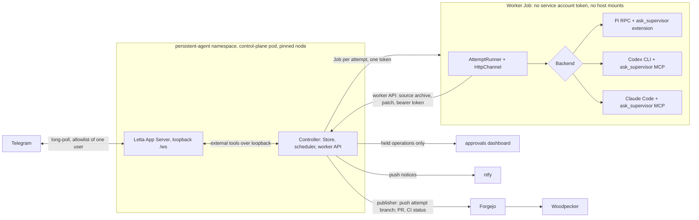

# Persistent agent architecture

Target architecture for [RFC-001](../research/2026-10-22-persistent-agent-pi-workers-rfc.md)
after the [Phase 0 audit](../research/2026-10-22-persistent-agent-audit.md) and
the operator decisions of 2026-10-22 and 2026-11-02. **Nothing here is deployed.** Offline
implementation is approved; deployment needs a separate authorization after
the gates in [Deployment gates](#deployment-gates) pass.

## Decisions

| Area | Decision |
| --- | --- |
| Worker runtimes | Pi is the preferred general runtime. Native CLI adapters run behind the same interface. Codex runs through the official Codex CLI with ChatGPT login. Claude runs through the unmodified Claude Code CLI with `claude setup-token`. Pi's `openai-codex` provider stays experimental. Pi never uses `anthropic`. Antigravity and Muse are deferred. |
| Supervisor inference | Primary (2026-11-02): a budget-capped API key, registered as a consumer in `config/spend.json` with the operator's monthly cap. Sign in with ChatGPT through Letta's `OpenAI (ChatGPT subscription)` connection replaces it once the upstream fixes below land in an audited release. No local model as the primary supervisor. No CLI-to-Letta inference proxy. |
| Rollout order | Phase 1: the controller and workers alone, fed by [alert intake](#alert-intake-phase-1). No supervisor, so no supervisor key. Phase 2: Letta and Telegram attach as the front door. |
| Paid APIs | None without explicit approval. Backends refuse API-key variables. |
| Credentials | A provisioning plan is approved. Shared credentials and automatic credential creation are not. pod-agent's logins and refresh jobs stay untouched. |
| Controller | One active controller, SQLite in WAL mode on a node-local volume, transactional claims, migrations, backups. |
| Approvals and notifications | Reuse the approvals dashboard and ntfy. |
| Packaging | Start from Letta Code's upstream flake (`packages.<system>.letta-code`, `nixosModules.default`) pinned to an audited tag. Build the OCI image from that package if the cluster needs one. |
| Placement | homelab-02, with a static `local-nvme` PV under `/persist/` (measured and approved 2026-11-02, see gate 2). Never homelab-05. Cluster-internal only. |
| Testing | A disposable Forgejo repository with explicitly scoped enrollment. |

## Components and trust boundaries

- The controller owns task truth (`docs/protocols/agent-tasks.md`). Letta,
  workers and Telegram only request changes.
- Worker text never enters Letta's conversation or the client API; it goes
  to the human on the forge issue and ntfy. An answer from Letta reaches a
  worker only after the principal's `/confirm` on the issue.
- A worker reaches the controller only through the worker API, with a token
  bound to its one live attempt. The token cannot answer questions, approve,
  complete, create tasks or read other attempts, and it stops working when the
  attempt ends. The worker never sees the SQLite file.
- Workers hold no forge credential and cannot reach the forge. They receive
  the base commit as an archive and return a patch; the publisher in the
  controller pod validates it and is the only Git writer. Verification and
  completion are bound to the commit it pushed. Nothing merges
  automatically.
- Completion has three stages: worker-reported (`settle`), verified
  (`record_verification`, from the controller's own Forgejo and Woodpecker
  reads), and finalized (`complete`, from the stored verification only). The
  last two are controller-only, and only finalization marks a task
  `completed`.
- Worker text is redacted before it is stored (`redact()` in
  `scripts/orchestrator/worker.py`).
- Repository content is untrusted. Claude Code runs with `--setting-sources
  user`, Codex with `--ignore-user-config --ignore-rules`, and Pi with
  `--no-approve --no-extensions --no-skills`.

## Supervisor inference audit

The supervisor must use a subscription only through a documented,
authorized mechanism, and must never use tokens taken from another
application's login. Evidence comes from OpenAI's Sign in with ChatGPT
developer documentation (read 2026-10-22) and from a read-only inspection of the
published `@letta-ai/letta-code` 0.34.20 tarball.

### The documented OpenAI mechanism

- First-time registration authorizes `client_id=dynamic_agent_client` with a
  per-host `ext_agent_host_id` and an `agent_name_hint` that should match the
  app's name. The callback returns an issued `client_id`, which is then used
  for the token exchange and every refresh.
- Plan usage needs the scopes `offline_access resource.invoke
  chatgpt.tokens.use.direct` and resource `https://api.openai.com/v1`. A valid
  ID token alone does not authorize plan usage.
- Inference goes to `POST https://api.openai.com/v1/responses` with `store:
  false` and `stream: true`, never to ChatGPT's `backend-api`. Usage-limit
  failures arrive as `subscription_sharing_usage_limit_exceeded` or
  `subscription_sharing_usage_unavailable`.
- Eligibility: the docs cover "open-source and locally hosted apps". A
  "self-hosted VM" is an explicitly supported agent host for the same user and
  workspace. Paid or remotely hosted apps offered to others need OpenAI's
  interest form.
- Self-hosted VMs: complete OAuth locally with the same tool, transfer the
  credential file over a secure channel, and keep a stable host ID that
  belongs to the VM. After that the VM owns refreshes. Preview limitation:
  host-specific usage attribution and per-host revocation of transferred
  sessions are not available yet, so revocation is per client.
- Limits are configured by the user in ChatGPT settings.

### What Letta 0.34.20 implements

Letta offers two different ChatGPT connections:

| Connection | Implementation | Verdict |
| --- | --- | --- |
| "ChatGPT Plus/Pro" (`openai-codex-oauth`, stored as `chatgpt-plus-pro`) | pi-ai `openai-codex` flow: Codex CLI client `app_EMoamEEZ73f0CkXaXp7hrann` (also in `codex` 0.163.0), `originator=codex_cli_rs`, device code at `auth.openai.com/codex/device`, inference at `chatgpt.com/backend-api` | Prohibited. It authorizes through another application's client, which is exactly the old flow. |
| "OpenAI (ChatGPT subscription)" (`openai-oauth`, stored as `lc-openai`, type `openai`) | pi-ai `openai-chatgpt` flow: `dynamic_agent_client` registration, `ext_agent_host_id=urn:uuid:<device id>`, PKCE with state and nonce, loopback `http://127.0.0.1:1455/auth/callback`, the three plan scopes, resource `https://api.openai.com/v1`, the issued client ID kept for refresh. It fails closed when the grant lacks `chatgpt.tokens.use.direct`. Inference uses provider `openai` at `https://api.openai.com/v1` over the Responses API with `store: false` and `stream: true`. | Matches the documented mechanism on every material point checked. |

Deviations in the compliant connection. Both block live sign-in until fixed:

1. **No ID-token verification.** OpenAI requires the client to verify the ID
   token's signature against OpenAI's JWKS
   (`https://auth.openai.com/.well-known/jwks.json`, RS256), its issuer
   (`https://auth.openai.com`), its audience (the issued client ID), its
   expiry, and the nonce of this attempt. It must then use the verified `sub`
   as the account identity, and confirm that a returning sign-in matches the
   stored identity before replacing credentials. pi-ai 0.99.2 (bundled by
   Letta 0.34.20) and pi-ai 1.4.0 (latest) send a nonce but check only that an
   ID token is present.
2. **Wrong `agent_name_hint`.** It is `"Pi"`. pi-ai 1.4.0 adds an
   `agentName` option, but Letta 0.34.20 is on pi-ai 0.99.2. OpenAI asks for
   the app's actual name, used consistently, sent only on first registration.

3. **The connection cannot complete.** Letta calls the login without
   `getDeviceId`, so pi-ai stops with "Sign in with ChatGPT requires a device
   ID (UUID) for this installation" before contacting OpenAI (0.34.20,
   0.34.21 and main, reproduced through Letta's own `runLocalOAuthConnectFlow`).

The fix is isolated upstream changes, prepared on local branches and not yet
submitted:

- pi-ai `fix/ai-chatgpt-id-token`: ID-token verification with `jose` 6.2.12
  (RS256 against OpenAI's JWKS, issuer, audience, expiry, nonce), the verified
  `sub` stored as `credential.subject`, `LoginOptions.expectedSubject` to
  reject a returning sign-in as another account, verification of ID tokens
  returned on refresh, and negative tests for each check.
- letta-code `fix/chatgpt-sign-in-device-id`: pass Letta's persistent device ID.
- A Letta follow-up once pi-ai releases the fix: adopt that pi-ai, pass
  `agentName` "Letta Code", and pass the stored `subject` as `expectedSubject`
  on reconnect.

Until all of these land in a pinned Letta release, `--allow-chatgpt-sign-in`
stays off.

### Eligibility of this deployment

Letta Code is open source (Apache-2.0). The deployment is self-hosted on the
operator's own hardware, for the operator alone, and is not offered to anyone
else. That matches the documented open-source, self-hosted agent host case,
not the paid or remotely hosted case that needs the interest form. This is a
reading of the published docs, not a confirmation from OpenAI. Live
verification at provisioning time (gate 6) closes it.

### Enforcement

`python -m scripts.orchestrator supervisor-audit --letta-dir <storage>
--allow-chatgpt-sign-in` is the required preflight before the App Server
starts (`scripts/orchestrator/supervisor_policy.py`). It passes only when:

- no provider is configured, or every provider is either
- exactly one `lc-openai` OAuth record of type `openai`, with an issued client
  ID that is neither the Codex client nor `dynamic_agent_client`, a granted
  `chatgpt.tokens.use.direct` scope, and no base-URL override, or
- an explicitly `--approve`d provider that uses an API key.

It fails on the Codex-client ChatGPT login (even when sign-in is allowed), an
OAuth record under any name other than `lc-openai`, any other OAuth login
(including Anthropic), an unreadable store, a model credential in the
environment, or an endpoint variable (`*_BASE_URL`, `*_API_BASE`,
`*_ENDPOINT`, `*_API_URL`) that could redirect the token. It never prints credential values. Without
`--allow-chatgpt-sign-in` every OAuth login fails, which is the fallback
posture if gate 6 fails.

If gate 6 fails, the prohibition stays, the old Codex flow is not adapted,
and the operator approves a budget-capped API key instead.

Pi's own `openai` provider uses the same documented flow, and its
`agent_name_hint` of `"Pi"` is accurate. A Pi worker signed in that way is
on the documented path. Pi's `openai-codex` provider remains experimental.

## Credentials

This is the provisioning plan. No value appears in Git, logs, task records, or
chat. Static secrets use the existing SOPS convention
(`gitops/secrets/<name>.sops.yaml`, see [secrets.md](../runbooks/secrets.md)).
Self-refreshing logins cannot live in SOPS, because their refresh tokens rotate
on use. The operator creates those inside their own volume, and each one has a
single writer.

| Credential | Identity and scope | Holder | Storage | Created by | Rotation |
| --- | --- | --- | --- | --- | --- |
| Letta ChatGPT sign-in | Letta's own issued client from the documented flow; one agent host (the control-plane pod's Letta device ID) | Letta App Server | `<letta storage>/providers/auth.json` on the control-plane PVC (0600) | Operator runs `letta connect` with "OpenAI (ChatGPT subscription)" using the same Letta version, then transfers the credential per OpenAI's self-hosted VM procedure. The local copy is deleted after transfer, because refresh tokens rotate | Revoke the client in ChatGPT settings (revocation is per client in the preview) and sign in again. Set a usage limit for the client in ChatGPT settings |
| Telegram bot token | New bot for the supervisor only; not pod-agent's bot | Letta channel runtime | SOPS secret, rendered by an init container into `channels/telegram/accounts.json` on the control-plane PVC (0600); DM policy `allowlist` with one user ID | Operator via BotFather | `/revoke` in BotFather, update SOPS, restart the pod |
| Codex worker login | Dedicated ChatGPT login session for the Codex CLI; not a copy of the laptop's or pod-agent's `auth.json` | Codex worker Jobs | `CODEX_HOME` on a dedicated worker-auth PVC (0700), mounted only into Codex Jobs | Operator runs `codex login --device-auth` in a one-off pod against that PVC | Re-run the device login and revoke the old session. One Codex Job at a time keeps a single refresh writer |
| Claude worker token | `claude setup-token` one-year OAuth token for the operator's subscription | Claude Code Jobs | SOPS secret mounted as a file (`token_file`). The backend reads it into `CLAUDE_CODE_OAUTH_TOKEN` at launch | Operator runs `claude setup-token` locally | Mint a new token, update SOPS, redeploy, revoke the old one. Calendar reminder before expiry |
| Forgejo publisher token | New user `agent-publisher`: write collaborator on the disposable test repository only; scopes `read:repository`, `write:repository`; no issue scopes, no repository or organization creation, no admin | The publisher in the controller pod only; never a worker | SOPS secret key `forge-publisher-token` in the controller Secret | Operator in the Forgejo UI | Generate the new token, update SOPS, revoke the old one. Branch protection blocks pushes to default branches; the publisher writes only `agent/<task>/<n>` branches with an expected-absent lease. The verifier ignores commit statuses not posted by the CI login |
| Forgejo controller token | New user `agent-controller`: read collaborator on the same repositories; scopes `read:user`, `read:repository`, `read:issue`, `write:issue` (comments) | Controller | SOPS secret | Operator | As above |
| ntfy publish credential | Existing ntfy service; publish-only to one topic | Controller | SOPS secret | Operator | Replace in ntfy, update SOPS |
| Worker API token | Random, one per attempt, SHA-256 stored | One worker Job | Kubernetes Secret created by the controller after its Job and owned by it, so Job deletion and TTL remove it | Controller at claim | Dies with the attempt |
| Budget-capped API key (fallback only) | Only if gate 6 fails and the operator approves | Letta | SOPS secret | Operator | Provider console |

### Claude credential boundary

`CLAUDE_CODE_OAUTH_TOKEN` is Claude Code's documented variable for a
`setup-token` token (authentication precedence step 5). Steps 1 to 4 are
cloud-provider switches, `ANTHROPIC_AUTH_TOKEN`, `ANTHROPIC_API_KEY` and
`apiKeyHelper`. The backend refuses the first three in its environment. The
worker's `CLAUDE_CONFIG_DIR` is provisioned empty and `--setting-sources user`
reads only that directory, so no `apiKeyHelper` can appear. The scripted e2e
test proves the binary sends the token as an OAuth bearer and sends no API
key. It does not prove subscription entitlement or billing; gate 6 checks that
live.

## Storage, placement, backup and restore

- The controller runs as a single replica pinned to one node, with a
  node-local volume (`local-path` or a hostPath PV with node affinity), never
  NFS. The store refuses network filesystems. `ControllerLock` fences
  processes on that node only. It is not cluster-wide fencing, so automatic
  relocation to another node is not allowed. Moving the controller is a
  manual, documented operation: stop it, back up, restore on the new node,
  start. Use a `Recreate` strategy and no PodDisruptionBudget eviction.
- Controller: `python -m scripts.orchestrator backup --db <db> <dest>`
  produces an integrity-checked copy. Schema upgrades snapshot first. Restore
  means stopping the controller, putting the backup in place with original
  ownership, running `check`, and starting it. Leases then return orphaned
  attempts to `ready`, and their Jobs receive `worker.cancel`.
- Letta: back up the whole Letta storage directory with the App Server
  stopped. It contains the ChatGPT refresh token and the Telegram bot token,
  so the backup destination must be encrypted.
- A restore test with a measured RPO and RTO is a deployment gate.

## Deployment gates

Each gate needs recorded evidence before deployment is requested.

1. **Offline acceptance.** `just check` and `just fmt-check` pass, and the
   opt-in real-binary tests pass (`ORCHESTRATOR_PI`, `ORCHESTRATOR_CODEX`,
   `ORCHESTRATOR_CLAUDE`).
2. **Resources.** Fresh measurements of homelab-02 and homelab-03, then the
   node choice. Job limits start at 2 CPU and 4 GiB with one concurrent Job.
3. **Security review** by a different model family of the design and the
   manifests, explicitly including credential boundaries: worker API scope,
   Claude token handling, Codex and Letta login stores, Telegram token, egress
   policy, Pod Security level and image provenance.
4. **Negative tests** in the rehearsal environment: a compromised Pi worker
   cannot read the controller database, the Letta store or other credentials,
   cannot use the worker API beyond its attempt, cannot reach the Kubernetes
   API or NAS, and cannot trigger privileged operations without a grant.
   Workers hold no forge credential (done offline: the trusted publisher,
   with tests over rendered manifests and a hostile scripted worker); the
   rehearsal repeats those checks against real pods.
5. **Credential provisioning** by the operator, per the plan above.
6. **Live subscription checks** at provisioning. OAuth success alone is not
   enough:
   - the Letta release in use verifies ID tokens and sends its own name;
   - the grant includes `chatgpt.tokens.use.direct` and the account has plan
     use enabled;
   - the first real inference request succeeds;
   - usage is attributed to the Letta client in ChatGPT settings, where a
     limit is set;
   - the Claude worker's usage appears against the subscription with no API
     billing.

   If any check fails, that path stays off. Plan usage is shared across every
   app on the ChatGPT plan, so autonomous supervisor activity draws from the
   same allowance as everything else; the per-client limit is the budget
   control.
7. **Packaging.** Build Letta from the upstream flake at an audited tag.
   Repeat the supervisor audit for any version newer than 0.34.20, because the
   preflight depends on its credential format.
8. **Supervisor tool authority** (done offline). No worker text reaches the
   supervisor: the client API returns identifiers and controller states only,
   and worker questions are read by the human on the issue. A supervisor's
   `answer_question` is a proposal the principal confirms with `/confirm` on
   the issue. Tests feed a worker question written as instructions to cancel,
   answer and approve, and check that neither Letta nor any client response
   sees it and that the obedient-supervisor path changes nothing. Automatic
   answers for narrow, low-risk question types would be explicit policies
   added later, not agent discretion.

## Vertical slice status

One supervisor creates a task, one isolated worker asks a question and gets
the answer, the controller verifies the result, and the supervisor reports
completion in the same conversation. No added concurrency or capabilities
until this works reliably.

Built and tested offline (`tests/test_orchestrator_slice.py`, with scripted
inference and disposable parts: a fake Forgejo backed by a real bare git
repository, a fake Letta App Server speaking the real protocol, a fake ntfy,
and a scripted Pi worker in a real process):

- the request arrives through the Letta bridge, the controller opens the issue
  and dispatches the worker, the worker asks and suspends, the controller
  restarts, the question survives and is answered through Letta after the
  restart, the worker submits a patch, the publisher pushes it, the
  controller opens the pull request, reads CI on the published commit,
  verifies, finalizes, and Letta hears the result;
- a crash just before and just after issue creation, and just before and just
  after pull request creation, converges to exactly one issue and one pull
  request;
- failed CI sends the task back for a new attempt instead of completing it;
- clients cannot see or act on another principal's tasks; forge commands
  count only from the principal's login.

The Kubernetes manifests are rendered, not committed:
`python -m scripts.orchestrator render-manifests --params FILE` takes the
node and the digest-pinned images as required inputs
(`scripts/orchestrator/manifests.py`), accepts only homelab-02 or
homelab-03, refuses unpinned images, checks the backend configuration
against a closed schema (unknown keys such as `env` are refused, values must
match their shape, and `token_file` and `codex_home` must be the approved
secret locations; the daemon applies the same check for Kubernetes jobs),
mounts into each worker Job only the Secret keys its backend needs, and renders a single `Recreate` controller pinned to that node with a
local PV, `restricted` Pod Security, worker Jobs without service-account
tokens, and default-deny NetworkPolicies. Nothing is bound into Flux.

Local worker processes (`LocalProcessJobManager`) give no isolation: a
worker runs as the controller's user. They exist for offline tests and
rehearsals only. The daemon offers them only behind `serve
--allow-local-jobs`, which no config file can set and the rendered
Deployment never passes, and the manager itself refuses to start inside a
Kubernetes pod.

## Alert intake (phase 1)

The first tasks come from operations, not from a supervisor
(`scripts/orchestrator/intake.py`):

- **Sources.** Alertmanager posts to the controller as a webhook receiver;
  cluster-sentinel posts each state change as a second notify target; the
  controller polls Woodpecker read-only for failed main pipelines. The
  restore drills (backups/restore-drill, immich/library-restore-drill, nas-01
  platform-restore-drill) reach it through sentinel's `restore-drills` check.
  Each source has its own bearer token, and the NetworkPolicy admits only
  Alertmanager and cluster-sentinel pods to the intake port.
- **Dedupe and limits.** A signal's fingerprint (alert labels, sentinel
  check key, or failed step names) opens at most one open task. At most
  three intake tasks are open at once; beyond that the signal escalates. A
  resolved signal cancels its task when no worker has started it. A task
  that fails twice escalates once. Escalations are the only ntfy messages
  intake tasks send; their routine status stays on the forge issue.
- **Evidence.** Workers stay off the private network. The controller attaches
  the alert, the affected pods' status (never their spec), events, recent
  logs and failing step logs, capped per section and in total and passed
  through the same `redact()` as worker text. The `orchestrator-evidence`
  ClusterRole grants pods (`get`, `list`), `pods/log` and events, and only
  RoleBindings use it, one per namespace enrolled in
  `config/orchestrator/evidence-namespaces.json`. The collector refuses any
  other namespace whatever an alert names, and finds a workload's pods by
  owner reference. A test requires every namespace the repository declares,
  and every one an alert rule or the sentinel names, to be either allowed or
  explicitly excluded (pod-agent, external-secrets, kube-system and the
  orchestrator's own namespace are excluded). The controller's namespaced
  Role can create and delete per-attempt Secrets but never read them.
- **Untrusted evidence.** Each intake task's goal is a fixed objective per
  source (`OBJECTIVES` in intake.py) followed by the evidence inside markers
  carrying a per-task random nonce; forged markers inside evidence are
  neutralized and titles are built from the source and signal name only.
- **Worker boundary.** `config/orchestrator/worker-admission.yaml`, an
  enforcement path, admits a Job from the controller's ServiceAccount only
  when it is exactly a worker: the pinned image, the worker ServiceAccount
  without a token, the worker label, a deadline, CPU and memory limits, no
  host namespaces, no privilege, non-root, no environment from Secrets or
  ConfigMaps, and only its own job Secret, the backend's keys of the worker
  Secret and the Codex store. No rendered role may change admission policies
  or RBAC. Worker public egress is TCP 443 to `PROVIDER_HOSTS` only, by FQDN
  in a CiliumNetworkPolicy. The publisher runs gitleaks over every patch's
  added lines and rejects on a finding or on any scan failure; published
  patches still go through CI and `policy/merge`.
- **Cutover.** The controller is added as a second Alertmanager receiver
  while ntfy keeps receiving everything. Warnings then move behind the
  controller first. Critical alerts go to both until autonomy metrics justify
  dropping ntfy. The controller's dead-man alert always goes straight to ntfy.
- **State.** `backup-rotate` snapshots the store nightly into the db-dumps
  share that dumps-to-r2 ships off site; the restore drill restores and
  checks the newest snapshot once the first one exists. Deleting the
  controller's PV stays held until a drill has passed.

## Gate evidence

- **Gate 2 (2026-11-02).** Requests left unreserved: homelab-02 about 2.9
  CPU and 5.4 GiB (55% memory in use), homelab-03 about 3.8 CPU and 3.5 GiB
  (75% in use); homelab-05 was over 100% CPU and memory. homelab-02 is the
  only node with room for one 4 GiB worker Job and the controller.
- **Gate 3 (2026-11-03), open.** Codex (codex-cli 0.162.1, read-only)
  reviewed the design, manifests, intake and credential boundaries. Sound:
  worker API attempt scoping, Pod Security, default-deny networking, digest
  pinning, the Claude launcher, publisher containment, backup integrity.
  Fixed after the review: redaction of titles and of URL credentials, Basic
  auth, password pairs, Telegram and long hex tokens; intake capacity checked
  before evidence is read, with one aggregated overflow notice per hour;
  bounded intake connections and Woodpecker reads; a dedicated backup volume
  instead of the shared dump export; a rendered Codex login store with one
  writer; an owner-only live store. The three high findings were addressed
  by the operator-approved designs (2026-11-03) described under alert
  intake: the worker Job admission policy, namespace enrollment for
  evidence, and trusted goals with provider-only egress and patch scanning.
  Reviewer: OpenAI `gpt-6.1-sol` through codex-cli, a different model family
  from the implementing agent (Anthropic Claude).
- **Gate 3 pass 2 (2026-11-03), open.** The same reviewer tried to break the
  fixes and found four high and two medium issues, fixed in response:
  - the policy trusted a Secret named like the Job, so a Job named after a
    credential Secret could mount it: Jobs must be named `orc-att-<id>` and
    may mount their own Secret only as `job.json`;
  - the rendered policy substituted unescaped parameters, so a crafted Secret
    name became CEL: the policy is now static and applied verbatim, and the
    renderer requires the image repository and Secret name it fixes;
  - DNS allowed every name, so queries could carry data to an outside
    nameserver, and `toFQDNs` allows IPs that providers share with other
    sites: DNS is limited to the provider names and cluster-internal names,
    the plain NetworkPolicy no longer grants workers DNS at L4, and TLS
    server names are pinned to the provider hosts;
  - the patch scan dropped lines starting `++`, honoured `gitleaks:allow` and
    never saw binary hunks: the publisher now scans every changed file's
    resulting content from the temporary index with built-in rules only and
    `--ignore-gitleaks-allow` (the hostile-worker test's loot, a binary file
    holding its token, is now refused);
  - signal names reached the title outside the evidence fence: titles are a
    fixed label per source and an opaque hash;
  - rendered workers wrote under the read-only `/job`: they run under `/work`.

  Accepted residual risk, by design: a worker can use its own provider
  credential and send data inside provider requests; fencing and secret
  scanning cannot stop prompt injection or deliberate encoding; the
  evidence role can read full Pod objects (specs included) in enrolled
  namespaces, though the collector keeps only status; the namespace coverage
  test scans `gitops/` and literal alert and sentinel names, not rendered
  Nix or Helm resources; `PROVIDER_HOSTS` is the union across backends, to be
  narrowed per backend from rehearsal traffic. A third pass is required
  before the gate closes, and the admission policy's CEL and the Cilium
  rules are proven only by gate 4's live negative tests.

Remaining before a deployment request:

| Priority | Work |
| --- | --- |
| P1 | Publish the Nix-built controller and worker images (`packages.orchestrator-*-image`) through a scoped `orchestrator-publish` operation and `publisher-orchestrator` identity |
| P1 | Credential-free rehearsal on homelab-02 with the rendered manifests, intake and a scripted loopback model |
| Gate | Gate 3 third review pass; gate 4 negative tests against real pods, including denied Jobs under the admission policy and refused DNS and TLS names; worker credential provisioning |
| Phase 2 | Letta from its upstream flake with the bridge beside it, the supervisor API key (capped in `config/spend.json` at 10 USD a month), Telegram |
| Parallel | Upstream Letta sign-in fixes (pi issue #11313, then the two PRs); not blocking |
