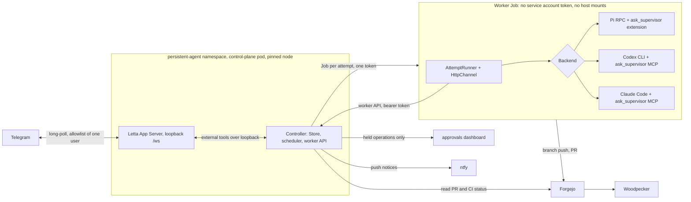

# Persistent agent architecture

Target architecture for [RFC-001](../research/2026-10-22-persistent-agent-pi-workers-rfc.md)
after the [Phase 0 audit](../research/2026-10-22-persistent-agent-audit.md) and
the operator decisions of 2026-10-22. **Nothing here is deployed.** Offline
implementation is approved; deployment needs a separate authorization after
the gates in [Deployment gates](#deployment-gates) pass.

## Decisions

| Area | Decision |
| --- | --- |
| Worker runtimes | Pi is the preferred general runtime. Native CLI adapters run behind the same interface. Codex runs through the official Codex CLI with ChatGPT login. Claude runs through the unmodified Claude Code CLI with `claude setup-token`. Pi's `openai-codex` provider stays experimental. Pi never uses `anthropic`. Antigravity and Muse are deferred. |
| Supervisor inference | First choice: OpenAI's documented Sign in with ChatGPT through Letta's `OpenAI (ChatGPT subscription)` connection (see the audit below). Fallback: a separately approved, budget-capped API key. No local model as the primary supervisor. No CLI-to-Letta inference proxy. |
| Paid APIs | None without explicit approval. Backends refuse API-key variables. |
| Credentials | A provisioning plan is approved. Shared credentials and automatic credential creation are not. pod-agent's logins and refresh jobs stay untouched. |
| Controller | One active controller, SQLite in WAL mode on a node-local volume, transactional claims, migrations, backups. |
| Approvals and notifications | Reuse the approvals dashboard and ntfy. |
| Packaging | Start from Letta Code's upstream flake (`packages.<system>.letta-code`, `nixosModules.default`) pinned to an audited tag. Build the OCI image from that package if the cluster needs one. |
| Placement | Choose homelab-02 or homelab-03 only after fresh resource measurements. Never homelab-05. Cluster-internal only. |
| Testing | A disposable Forgejo repository with explicitly scoped enrollment. |

## Components and trust boundaries

- The controller owns task truth (`docs/protocols/agent-tasks.md`). Letta,
  workers and Telegram only request changes.
- A worker reaches the controller only through the worker API, with a token
  bound to its one live attempt. The token cannot answer questions, approve,
  complete, create tasks or read other attempts, and it stops working when the
  attempt ends. The worker never sees the SQLite file.
- Completion has three stages: worker-reported (`settle`), verified
  (`record_verification`, from the controller's own Forgejo and Woodpecker
  reads), and finalized (`complete`, from the stored verification only). The
  last two are controller-only, and only finalization marks a task
  `completed`.
- Worker text is redacted before it is stored (`redact()` in
  `scripts/orchestrator/worker.py`).
- Repository content is untrusted. Claude Code runs with `--setting-sources
  user`, Codex with `--ignore-user-config --ignore-rules`, and Pi with
  `--no-approve --no-extensions --no-skills`.

## Supervisor inference audit

The supervisor must use a subscription only through a documented,
authorized mechanism, and must never use tokens taken from another
application's login. Evidence comes from OpenAI's Sign in with ChatGPT
developer documentation (read 2026-10-22) and from a read-only inspection of the
published `@letta-ai/letta-code` 0.34.20 tarball.

### The documented OpenAI mechanism

- First-time registration authorizes `client_id=dynamic_agent_client` with a
  per-host `ext_agent_host_id` and an `agent_name_hint` that should match the
  app's name. The callback returns an issued `client_id`, which is then used
  for the token exchange and every refresh.
- Plan usage needs the scopes `offline_access resource.invoke
  chatgpt.tokens.use.direct` and resource `https://api.openai.com/v1`. A valid
  ID token alone does not authorize plan usage.
- Inference goes to `POST https://api.openai.com/v1/responses` with `store:
  false` and `stream: true`, never to ChatGPT's `backend-api`. Usage-limit
  failures arrive as `subscription_sharing_usage_limit_exceeded` or
  `subscription_sharing_usage_unavailable`.
- Eligibility: the docs cover "open-source and locally hosted apps". A
  "self-hosted VM" is an explicitly supported agent host for the same user and
  workspace. Paid or remotely hosted apps offered to others need OpenAI's
  interest form.
- Self-hosted VMs: complete OAuth locally with the same tool, transfer the
  credential file over a secure channel, and keep a stable host ID that
  belongs to the VM. After that the VM owns refreshes. Preview limitation:
  host-specific usage attribution and per-host revocation of transferred
  sessions are not available yet, so revocation is per client.
- Limits are configured by the user in ChatGPT settings.

### What Letta 0.34.20 implements

Letta offers two different ChatGPT connections:

| Connection | Implementation | Verdict |
| --- | --- | --- |
| "ChatGPT Plus/Pro" (`openai-codex-oauth`, stored as `chatgpt-plus-pro`) | pi-ai `openai-codex` flow: Codex CLI client `app_EMoamEEZ73f0CkXaXp7hrann` (also in `codex` 0.163.0), `originator=codex_cli_rs`, device code at `auth.openai.com/codex/device`, inference at `chatgpt.com/backend-api` | Prohibited. It authorizes through another application's client, which is exactly the old flow. |
| "OpenAI (ChatGPT subscription)" (`openai-oauth`, stored as `lc-openai`, type `openai`) | pi-ai `openai-chatgpt` flow: `dynamic_agent_client` registration, `ext_agent_host_id=urn:uuid:<device id>`, PKCE with state and nonce, loopback `http://127.0.0.1:1455/auth/callback`, the three plan scopes, resource `https://api.openai.com/v1`, the issued client ID kept for refresh. It fails closed when the grant lacks `chatgpt.tokens.use.direct`. Inference uses provider `openai` at `https://api.openai.com/v1` over the Responses API with `store: false` and `stream: true`. | Matches the documented mechanism on every material point checked. |

Deviations in the compliant connection. Both block live sign-in until fixed:

1. **No ID-token verification.** OpenAI requires the client to verify the ID
   token's signature against OpenAI's JWKS
   (`https://auth.openai.com/.well-known/jwks.json`, RS256), its issuer
   (`https://auth.openai.com`), its audience (the issued client ID), its
   expiry, and the nonce of this attempt. It must then use the verified `sub`
   as the account identity, and confirm that a returning sign-in matches the
   stored identity before replacing credentials. pi-ai 0.99.2 (bundled by
   Letta 0.34.20) and pi-ai 1.4.0 (latest) send a nonce but check only that an
   ID token is present.
2. **Wrong `agent_name_hint`.** It is `"Pi"`. pi-ai 1.4.0 adds an
   `agentName` option, but Letta 0.34.20 is on pi-ai 0.99.2. OpenAI asks for
   the app's actual name, used consistently, sent only on first registration.

3. **The connection cannot complete.** Letta calls the login without
   `getDeviceId`, so pi-ai stops with "Sign in with ChatGPT requires a device
   ID (UUID) for this installation" before contacting OpenAI (0.34.20,
   0.34.21 and main, reproduced through Letta's own `runLocalOAuthConnectFlow`).

The fix is isolated upstream changes, prepared on local branches and not yet
submitted:

- pi-ai `fix/ai-chatgpt-id-token`: ID-token verification with `jose` 6.2.12
  (RS256 against OpenAI's JWKS, issuer, audience, expiry, nonce), the verified
  `sub` stored as `credential.subject`, `LoginOptions.expectedSubject` to
  reject a returning sign-in as another account, verification of ID tokens
  returned on refresh, and negative tests for each check.
- letta-code `fix/chatgpt-sign-in-device-id`: pass Letta's persistent device ID.
- A Letta follow-up once pi-ai releases the fix: adopt that pi-ai, pass
  `agentName` "Letta Code", and pass the stored `subject` as `expectedSubject`
  on reconnect.

Until all of these land in a pinned Letta release, `--allow-chatgpt-sign-in`
stays off.

### Eligibility of this deployment

Letta Code is open source (Apache-2.0). The deployment is self-hosted on the
operator's own hardware, for the operator alone, and is not offered to anyone
else. That matches the documented open-source, self-hosted agent host case,
not the paid or remotely hosted case that needs the interest form. This is a
reading of the published docs, not a confirmation from OpenAI. Live
verification at provisioning time (gate 6) closes it.

### Enforcement

`python -m scripts.orchestrator supervisor-audit --letta-dir <storage>
--allow-chatgpt-sign-in` is the required preflight before the App Server
starts (`scripts/orchestrator/supervisor_policy.py`). It passes only when:

- no provider is configured, or every provider is either
- exactly one `lc-openai` OAuth record of type `openai`, with an issued client
  ID that is neither the Codex client nor `dynamic_agent_client`, a granted
  `chatgpt.tokens.use.direct` scope, and no base-URL override, or
- an explicitly `--approve`d provider that uses an API key.

It fails on the Codex-client ChatGPT login (even when sign-in is allowed), an
OAuth record under any name other than `lc-openai`, any other OAuth login
(including Anthropic), an unreadable store, a model credential in the
environment, or an endpoint variable (`*_BASE_URL`, `*_API_BASE`,
`*_ENDPOINT`, `*_API_URL`) that could redirect the token. It never prints credential values. Without
`--allow-chatgpt-sign-in` every OAuth login fails, which is the fallback
posture if gate 6 fails.

If gate 6 fails, the prohibition stays, the old Codex flow is not adapted,
and the operator approves a budget-capped API key instead.

Pi's own `openai` provider uses the same documented flow, and its
`agent_name_hint` of `"Pi"` is accurate. A Pi worker signed in that way is
on the documented path. Pi's `openai-codex` provider remains experimental.

## Credentials

This is the provisioning plan. No value appears in Git, logs, task records, or
chat. Static secrets use the existing SOPS convention
(`gitops/secrets/<name>.sops.yaml`, see [secrets.md](../runbooks/secrets.md)).
Self-refreshing logins cannot live in SOPS, because their refresh tokens rotate
on use. The operator creates those inside their own volume, and each one has a
single writer.

| Credential | Identity and scope | Holder | Storage | Created by | Rotation |
| --- | --- | --- | --- | --- | --- |
| Letta ChatGPT sign-in | Letta's own issued client from the documented flow; one agent host (the control-plane pod's Letta device ID) | Letta App Server | `<letta storage>/providers/auth.json` on the control-plane PVC (0600) | Operator runs `letta connect` with "OpenAI (ChatGPT subscription)" using the same Letta version, then transfers the credential per OpenAI's self-hosted VM procedure. The local copy is deleted after transfer, because refresh tokens rotate | Revoke the client in ChatGPT settings (revocation is per client in the preview) and sign in again. Set a usage limit for the client in ChatGPT settings |
| Telegram bot token | New bot for the supervisor only; not pod-agent's bot | Letta channel runtime | SOPS secret, rendered by an init container into `channels/telegram/accounts.json` on the control-plane PVC (0600); DM policy `allowlist` with one user ID | Operator via BotFather | `/revoke` in BotFather, update SOPS, restart the pod |
| Codex worker login | Dedicated ChatGPT login session for the Codex CLI; not a copy of the laptop's or pod-agent's `auth.json` | Codex worker Jobs | `CODEX_HOME` on a dedicated worker-auth PVC (0700), mounted only into Codex Jobs | Operator runs `codex login --device-auth` in a one-off pod against that PVC | Re-run the device login and revoke the old session. One Codex Job at a time keeps a single refresh writer |
| Claude worker token | `claude setup-token` one-year OAuth token for the operator's subscription | Claude Code Jobs | SOPS secret mounted as a file (`token_file`). The backend reads it into `CLAUDE_CODE_OAUTH_TOKEN` at launch | Operator runs `claude setup-token` locally | Mint a new token, update SOPS, redeploy, revoke the old one. Calendar reminder before expiry |
| Forgejo worker token | New user `agent-worker`: write collaborator on the disposable test repository only; scopes `read:user`, `read:repository`, `write:repository`, `read:issue`, `write:issue`; no repository or organization creation; no admin | Worker Jobs | SOPS secret, mounted per Job | Operator in the Forgejo UI | Generate the new token, update SOPS, revoke the old one. Branch protection blocks pushes to default branches |
| Forgejo controller token | New user `agent-controller`: read collaborator on the same repositories; scopes `read:user`, `read:repository`, `read:issue`, `write:issue` (comments) | Controller | SOPS secret | Operator | As above |
| ntfy publish credential | Existing ntfy service; publish-only to one topic | Controller | SOPS secret | Operator | Replace in ntfy, update SOPS |
| Worker API token | Random, one per attempt, SHA-256 stored | One worker Job | Kubernetes Secret created and deleted by the controller with the Job | Controller at claim | Dies with the attempt |
| Budget-capped API key (fallback only) | Only if gate 6 fails and the operator approves | Letta | SOPS secret | Operator | Provider console |

### Claude credential boundary

`CLAUDE_CODE_OAUTH_TOKEN` is Claude Code's documented variable for a
`setup-token` token (authentication precedence step 5). Steps 1 to 4 are
cloud-provider switches, `ANTHROPIC_AUTH_TOKEN`, `ANTHROPIC_API_KEY` and
`apiKeyHelper`. The backend refuses the first three in its environment. The
worker's `CLAUDE_CONFIG_DIR` is provisioned empty and `--setting-sources user`
reads only that directory, so no `apiKeyHelper` can appear. The scripted e2e
test proves the binary sends the token as an OAuth bearer and sends no API
key. It does not prove subscription entitlement or billing; gate 6 checks that
live.

## Storage, placement, backup and restore

- The controller runs as a single replica pinned to one node, with a
  node-local volume (`local-path` or a hostPath PV with node affinity), never
  NFS. The store refuses network filesystems. `ControllerLock` fences
  processes on that node only. It is not cluster-wide fencing, so automatic
  relocation to another node is not allowed. Moving the controller is a
  manual, documented operation: stop it, back up, restore on the new node,
  start. Use a `Recreate` strategy and no PodDisruptionBudget eviction.
- Controller: `python -m scripts.orchestrator backup --db <db> <dest>`
  produces an integrity-checked copy. Schema upgrades snapshot first. Restore
  means stopping the controller, putting the backup in place with original
  ownership, running `check`, and starting it. Leases then return orphaned
  attempts to `ready`, and their Jobs receive `worker.cancel`.
- Letta: back up the whole Letta storage directory with the App Server
  stopped. It contains the ChatGPT refresh token and the Telegram bot token,
  so the backup destination must be encrypted.
- A restore test with a measured RPO and RTO is a deployment gate.

## Deployment gates

Each gate needs recorded evidence before deployment is requested.

1. **Offline acceptance.** `just check` and `just fmt-check` pass, and the
   opt-in real-binary tests pass (`ORCHESTRATOR_PI`, `ORCHESTRATOR_CODEX`,
   `ORCHESTRATOR_CLAUDE`).
2. **Resources.** Fresh measurements of homelab-02 and homelab-03, then the
   node choice. Job limits start at 2 CPU and 4 GiB with one concurrent Job.
3. **Security review** by a different model family of the design and the
   manifests, explicitly including credential boundaries: worker API scope,
   Claude token handling, Codex and Letta login stores, Telegram token, egress
   policy, Pod Security level and image provenance.
4. **Negative tests** in the rehearsal environment: a compromised Pi worker
   cannot read the controller database, the Letta store or other credentials,
   cannot use the worker API beyond its attempt, cannot reach the Kubernetes
   API or NAS, and cannot trigger privileged operations without a grant.
5. **Credential provisioning** by the operator, per the plan above.
6. **Live subscription checks** at provisioning. OAuth success alone is not
   enough:
   - the Letta release in use verifies ID tokens and sends its own name;
   - the grant includes `chatgpt.tokens.use.direct` and the account has plan
     use enabled;
   - the first real inference request succeeds;
   - usage is attributed to the Letta client in ChatGPT settings, where a
     limit is set;
   - the Claude worker's usage appears against the subscription with no API
     billing.

   If any check fails, that path stays off. Plan usage is shared across every
   app on the ChatGPT plan, so autonomous supervisor activity draws from the
   same allowance as everything else; the per-client limit is the budget
   control.
7. **Packaging.** Build Letta from the upstream flake at an audited tag.
   Repeat the supervisor audit for any version newer than 0.34.20, because the
   preflight depends on its credential format.

## Next milestone: one vertical slice

One Letta supervisor creates a task, launches one isolated worker, answers
its question, receives a verified result, and reports completion in the same
conversation. No added concurrency or capabilities until this works reliably.
Built so far: the store, the worker runner and API, and three backends.

| Priority | Work | Acceptance |
| --- | --- | --- |
| P0 | Letta OAuth identity validation upstream (pi-ai verification, Letta name) | Signature, issuer, audience, expiry, nonce and `sub` binding tested, including negative cases |
| P1 | Controller daemon: scheduler (claim, token, Job), reaper, Job manager acknowledging `worker.cancel` after deleting the Job, worker API server, outbox delivery | Restarts, leases, cancellations and fencing behave correctly |
| P1 | Letta bridge: external tools `create_task`, `get_task`, `list_tasks`, `cancel_task`, `answer_question`, `request_approval`, re-registered on every reconnect | The supervisor manages tasks without bypassing controller authorization |
| P1 | Forgejo and Woodpecker adapters: issue per task, attempt-scoped branch, PR, status reads feeding `record_verification` | Issues, PRs, CI results and comments reconcile idempotently |
| P1 | ntfy notifier | Durable, deduplicated delivery with retries |
| P2 | Packaging (Letta from the upstream flake, controller and worker images) and resource checks | Reproducible images, chosen node, isolated credentials |
| P2 | Credential-free rehearsal with a scripted loopback model | The full path works, plus worker crash, controller restart, stale attempt, duplicate events, cancelled task, and an answer after expiry. The question round trip runs through Letta and Telegram routing, not only the worker adapters |
