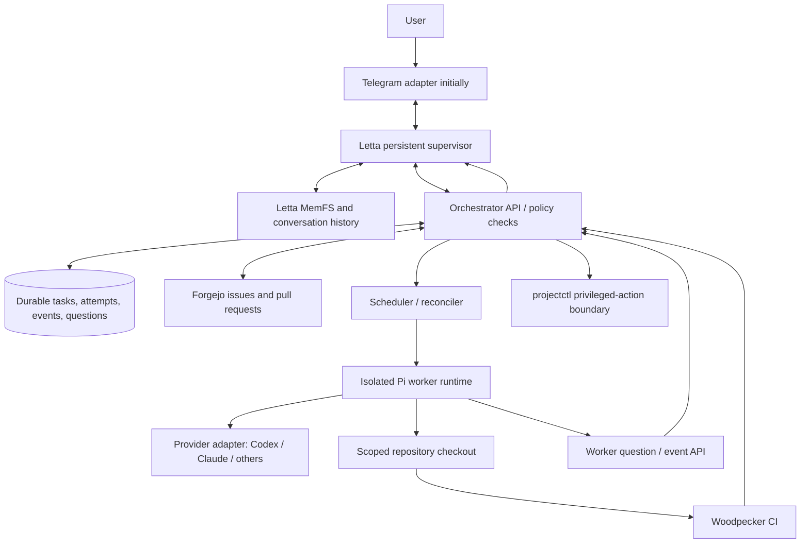

# RFC-001: Persistent Personal Agent with Pi Worker Fleet

- **Status:** Draft for repository audit, not authorization to deploy
- **Date:** 2026-10-22
- **Priority:** Audit-first proof of concept
- **Intended environment:** Existing self-hosted NixOS/Kubernetes homelab with Forgejo, Woodpecker CI, PostgreSQL where available, and the in-progress `projectctl` authorization/execution work.

## 1. Executive decision

Build **one persistent, user-facing Letta agent** as the conversational supervisor and **Pi as the primary worker runtime**. Put a **small, durable, deterministic orchestrator** between the supervisor and workers. Reuse **Forgejo** for human-readable issues/PRs and **projectctl** for existing trusted provisioning/authorization boundaries. OpenHands is **not required** for the first implementation; retain it only as a candidate alternative worker backend.

**Do not implement from this RFC without auditing the actual repositories, deployed topology, existing protocols, and current upstream interfaces.** The audit may recommend a narrower design or replace components when evidence supports it. The goal is the smallest reliable system satisfying the behavior below, not a new platform duplicated alongside existing infrastructure.

## 2. Desired user experience

The user communicates with **one agent identity** via Telegram initially, with web chat and voice as future adapters. The agent retains conversations and useful long-term context. It can create, split, prioritize, and discuss tasks; dispatch work; answer routine worker questions; request decisions and approvals; and report verified outcomes.

**Example:** “Improve the voice assistant's reliability.” The supervisor inspects the project context, creates a parent task and executable subtasks, requests/obtains approved scopes, dispatches one or more Pi workers, routes blockers and questions to the user, then summarizes linked PRs, tests, and changes. The user can ask unrelated questions while work runs.

**Invariants:**

1. A *single user-facing persona* does **not** imply one always-running LLM inference process or a single giant context window. State must survive agent, pod, and node restarts.
2. Agents may propose work, but **durable task and authorization state is not stored in agent memory**.
3. Worker output is evidence to verify, **not proof of successful completion**.
4. Workers have isolated workspaces, bounded credentials, budgets, and capabilities. Privileged work goes through audited existing mechanisms, never direct cluster/host admin credentials.
5. Changes to upstream repositories or deployment architecture must preserve existing source-of-truth and recovery guarantees.

## 3. Scope and non-goals

### MVP scope

- One Letta agent using a self-hosted/local state backend, persisted across restarts.
- One authenticated Telegram DM mapped to the intended agent/conversation; strict sender allowlist.
- Minimal controller with `create_task`, `get_task`, `list_tasks`, `cancel_task`, `answer_question`, and `request_approval` capabilities exposed to Letta through documented external tools.
- Forgejo issue per approved executable task (or linked parent/subtask) and PR per coding outcome.
- One Pi worker at a time, launched in an isolated runtime, controlled through Pi RPC or an SDK adapter if audit justifies it.
- First worker provider: **OpenAI Codex using an approved subscription-authenticated flow**. Claude is a required next-provider gate; Antigravity follows; Muse is optional.
- Status changes, worker events, session references, user questions, and retry history stored durably in an existing suitable database.
- Woodpecker CI and explicit acceptance checks before marking work complete.

### Explicit non-goals for MVP

- No production-critical infrastructure mutation, autonomous merges to protected branches, or autonomous credential administration.
- No full self-service cloud, generalized multi-agent framework, novel memory research implementation, or custom task-board UI.
- No OpenHands deployment unless audit identifies a concrete missing Pi capability.
- No assumption that provider OAuth means use is included in a paid subscription or permitted for unattended automation.
- No introduction of Temporal, a message broker, Kubernetes operators, or extra databases absent a demonstrated need.

## 4. Logical architecture



### Ownership boundaries

| Owner | Responsibilities | Must not own |
|---|---|---|
| Letta supervisor | Conversation, identity, preferences, planning, delegation, user-facing responses | Task truth, worker lease ownership, approval enforcement |
| Orchestrator/controller | Task state, dependency checks, admission policy, scheduling, events, question routing, retries, notification outbox | Free-form reasoning, code changes, unrestricted host access |
| Pi worker | Execute a scoped task, edit code, run tests, submit artifacts/PRs, ask questions | Global memory edits, direct task-state mutation, privileged platform credentials |
| Forgejo | Human-readable issues, comments, boards if supported, branches, PRs, review provenance | Runtime leases or transactional queue semantics |
| Woodpecker CI | Reproducible validation artifacts and status checks | Agent-reported success as a substitute for tests |
| projectctl | Existing trusted authorization, verified privileged execution/recovery | General chat, task planning, memory |

**Integration rule:** Prefer adapters calling existing Forgejo/projectctl APIs over replacing or forking those systems. Discover their real contracts during audit.

## 5. Audit gate: required before implementation

The first agent assigned this document must produce `docs/audits/persistent-agent-audit.md` (or an existing convention), **without modifying infrastructure or granting credentials**. After the audit, proceed automatically only with work inside already-approved scopes and with passing audit gates; escalate material unknowns rather than guessing.

Audit and record:

1. **Repo/source-of-truth:** Identify authoritative NixOS, Kubernetes/GitOps, Forgejo, Woodpecker, projectctl, secrets, policy, and runbook repositories/paths. Note worktrees and in-progress PRs. Do not create conflicting manifests.
2. **Existing functionality:** Inventory current projectctl grants, job/agent protocol, ticket interfaces, event/log formats, sandboxing, reconciliation, CI triggers, notification delivery, and recovery. Identify what can be reused unchanged.
3. **Placement/resources:** Select control-plane and worker hosts based on actual capacity, persistence, availability, network boundaries, and isolation support. Decide whether Kubernetes Jobs, pods, or existing execution workers are the best fit.
4. **Letta feasibility:** Pin version/commit; validate active `letta-ai/letta-code` and local App Server semantics, Telegram routing, memory storage path, reconnect behavior, external tool callbacks, and whether required model access exists. Avoid implementing against legacy Letta V1 assumptions.
5. **Pi feasibility:** Pin version/commit; validate RPC/SDK APIs, session persistence, extensions, explicit model selection, event semantics, exit recovery, UI-question requests, and sandbox requirements.
6. **Subscription/auth feasibility:** For **Codex and Claude separately**, confirm authorized OAuth path, provider terms, whether use consumes included subscription quota vs extra metered billing, token refresh, rate/concurrency limits, and headless behavior. Antigravity and Muse are lower priority. Record *verified*, *unsupported*, or *unknown*, never inferred.
7. **Forgejo/CI:** Confirm installed Forgejo version and its API/webhook/issue/project support, access tokens, Woodpecker PR pipelines, merge protections, idempotent issue/PR creation, and status verification.
8. **Threat/recovery analysis:** Credential access, malicious repository instructions, extension supply chain, prompt injection, unauthorized Telegram users, compromised workers, task duplication, DB/Letta restore, and stale questions/approvals.
9. **Design delta:** Produce a reuse-versus-build matrix, exact API/version references, an implementation plan with small reversible PRs, remaining uncertainties, and a rollback plan.

**Gate A pass:** The audit demonstrates a compatible, low-risk MVP path with no unresolved material assumptions, and the planned work fits existing operator-approved scopes. The implementing agent may then proceed with **nonprivileged, reversible, reviewable PRs**. Seek explicit operator approval for missing scopes, new externally exposed services, novel credential access, material architecture changes, or deployments outside existing grants. No deployment or privilege escalation is implicitly authorized by this RFC.

## 6. Letta supervisor and memory

Use the **current Letta Code/App Server**, not the retired V1 server. For MVP use local, operator-controlled persistent storage and a Telegram allowlist. Consider the documented Letta Agent SDK and **App Server external tools** to expose only constrained controller actions. A successful model tool call requests a controller action; it does not bypass validation or authorization.

Define stable identities: `principal_id`, `agent_id`, `conversation_id`, `channel_id`, and `channel_message_id`. Persist a deduplication mapping for delivered inbound/outbound messages. Multiple channels should map to the same principal and persistent identity but need **serialized updates or conversation-specific locks** to avoid concurrent-turn corruption. Letta App Server external tools are connection-scoped: the controller must re-register them after reconnect and reconcile agent events against durable controller state. Do not assume all channel messages should share one unrestricted chat thread without evaluating Letta behavior.

Memory policy:

- **Letta MemFS:** Durable user preferences, project summaries, standing policies, decisions, and lessons. Include source/timestamp and validity when feasible.
- **Chat transcript:** Preserve actual message history in Letta; export/backup it according to validated storage semantics.
- **Project knowledge:** Repositories and docs remain authoritative; memory stores pointers and concise summaries, not copies that drift.
- **Operational truth:** PostgreSQL (or existing durable controller store) is authoritative for task, attempt, question, approval, lease, and notification state.
- **Dreaming:** Optional after baseline passes. Assess information retention, mistaken conclusions, token cost, user-review controls, and restoration before enabling broad consolidation.
- **mem0/xMemory:** Defer. Evaluate against a fixed recall benchmark only if Letta native memory measurably fails requirements. Keep `MemoryProvider` replaceable; do not stack systems by default.

## 7. Orchestrator domain model and transitions

Use the existing DB if suitable. Schema below is **conceptual**, not a prescribed ORM/database migration:

- `tasks`: `id`, `project`, `title`, `goal`, `acceptance_criteria`, `priority`, `created_by`, `status`, `parent_id`, `external_issue_ref`, `requested_capabilities`, `policy_version`, `created_at`, `updated_at`.
- `dependencies`: `task_id`, `depends_on_task_id` with cycle prevention.
- `attempts`: `id`, `task_id`, `attempt_no`, `worker_backend`, `provider`, `model`, `workspace_ref`, `session_ref`, `lease_owner`, `lease_expires_at`, `started_at`, `finished_at`, `exit_reason`.
- `events`: immutable `event_id`, `task_id`, `attempt_id`, `type`, `timestamp`, `actor`, `payload`, `correlation_id` (redacted and size-limited).
- `questions`: `id`, `task_id`, `attempt_id`, `prompt`, `choices`, `blocking`, `status`, `answer`, `answered_by`, `deadline`, `revision`.
- `approvals`: `id`, `task_id`, `action_digest`, `capability_scope`, `actor`, `decision`, `expires_at`, `policy_version`; **never reuse on changed inputs**.
- `outbox`: durable notification/webhook messages with idempotency key, delivery attempts, and acknowledgement.

Task state proposal:

`draft -> ready -> claimed -> running -> validating -> in_review -> completed`

Additional transitions: `running <-> needs_input`; `running/validating -> retryable_failed -> ready` after policy checks; any eligible state `-> cancelled`; terminal `failed`. A **task** may have multiple **attempts**; attempts have their own terminal states. `completed` requires verifiable evidence and policy checks, not only a Pi final message. Store per-task transition history; reject invalid/out-of-order transitions.

Use transactional task claiming/leases and a reconciliation loop. Scheduling should enforce dependency completion, concurrency caps, rate limits, per-provider quotas, and capability/resource requirements. Assume at-least-once event/webhook delivery; implement idempotency and a DB outbox. Never depend on exactly-once transport.

## 8. Worker protocol and Pi integration

Prefer **Pi RPC** for isolated long-lived processes: JSONL over stdin/stdout, unique request IDs, continuous event consumption, stderr for diagnostics. The implementation must use the version-pinned official protocol, not guessed event names or raw LLM chat text.

Worker lifecycle:

1. Admit a task only after validating its repo, scope, acceptance criteria, approved provider, resource limits, dependency state, and work authorization.
2. Allocate isolated workspace; clone allowed repository at recorded base commit; inject *only* scoped credentials through the approved secrets system.
3. Launch a Pi process for the task/attempt with pinned version, model/provider, working directory, session persistence path, and the `ask_supervisor` extension/tool.
4. Send task brief and constraints via RPC. A successful `prompt` response means **accepted**, not **finished**; consume events until the supported settled/idle signal or a terminal failure. Handle extension UI requests if exposed.
5. Stream summarized, redacted progress events. Record session/artifact references; preserve full raw logs only in access-controlled stores with retention policy.
6. On blockers, emit a structured question to the controller and suspend/park the attempt safely; on answer, resume the same attempt if valid, otherwise open a new attempt with the prior context.
7. After coding, run CI/checks; open PR to an allowed branch; independently inspect PR, CI status, acceptance criteria, and risk policy before promoting task state.
8. On timeout, process exit, cancellation, invalid output, or node loss, release resources, reconcile leases, and retry only when safe. No duplicate branch/PR/side effect creation.

Suggested adapter interface (illustrative; finalize after audit):

```ts
interface WorkerAdapter {
  startTask(taskId: string, attemptId: string, scope: CapabilityScope): Promise<WorkerHandle>;
  sendAnswer(attemptId: string, questionId: string, answer: string): Promise<void>;
  cancel(attemptId: string, reason: string): Promise<void>;
  inspect(attemptId: string): Promise<WorkerState>;
  recover(attemptId: string): Promise<WorkerState>;
}
```

Model-provider adapters are separate from worker adapters. Initial routing: Codex first, Claude second, Antigravity optional, Muse experimental. Allow multiple provider logins **only where documented, permitted, and tested**. Rate-limit and monitor each separately; failure to prove subscription coverage must fail closed or require explicit operator approval of API billing. Do not automate deceptive client impersonation or bypass provider restrictions.

## 9. Questions, approvals, and supervisor interaction

Treat **questions** (information) and **approvals** (authorization) as different objects.

Proposed machine-readable worker question event:

```json
{
  "type": "worker.question",
  "event_id": "uuid",
  "task_id": "uuid",
  "attempt_id": "uuid",
  "question_id": "uuid",
  "blocking": true,
  "prompt": "Should the service use local accounts or OAuth?",
  "options": ["local", "oauth", "discuss"],
  "context_ref": "artifact-or-log-reference",
  "revision": 1
}
```

Routing:

- Persist event/question **before** notifying Telegram or posting a Forgejo issue comment.
- Letta may answer a **non-privileged factual question** if a current trusted instruction/source clearly resolves it, and its answer is recorded with provenance.
- Ask the user when requirements are ambiguous, preferences conflict, cost/architecture changes materially, or an external/privileged action needs permission.
- The same `question_id` supports replies via Telegram or issue board; first valid answer wins (revision check), later conflicting answers trigger a follow-up rather than silently overriding.
- Approvals must bind an exact `action_digest`, time-limited capabilities, resource/repository targets, and principal. No generic “yes” grants blanket powers.
- The task may park while waiting; worker must not consume compute indefinitely. On user reply, validate that the attempt and requested action are still current.

Supervisor notifications: initial dispatch; important blockers; review-ready PR; completion/failure; periodic summary when requested. Avoid streaming every tool call into chat. Cancellation from Telegram must propagate to the scheduler and worker; verify termination before reporting it as completed.

## 10. Security and operational policy

- **Deny by default.** Scoped least-privilege grants; separate chat/controller identities from worker identities and privileged projectctl operations.
- **Isolation:** No host Docker socket, unbounded host mounts, cluster-admin kubeconfig, or NAS root access in standard workers. Use separate runtime identities, restricted mounts, network egress rules, CPU/memory/time limits, and per-task workspaces.
- **Credentials:** Treat Pi OAuth/token stores and Telegram tokens as secrets. Never commit, log, send to an LLM, or distribute broad auth files to untrusted workspaces. Audit how OAuth refresh works in headless isolated workers. Use a controlled credential-broker pattern only if the provider permits it and the mechanism is audited.
- **Untrusted content:** Repository instructions, web pages, issues, and worker logs are data, not authority to change permissions. Tool calls are validated in the controller/policy layer.
- **Supply chain:** Pin Letta/Pi/extensions and verify source/license/update process. New Pi extensions require review before entering privileged or credentialed images.
- **Review gates:** Changes to CI policies, secret-management paths, auth, network/firewall, storage, backups, or production deployments require explicit policy and usually human approval. No unattended merge/deploy until a separate audit and authorization gate.
- **Observability:** Correlation IDs across chat, tasks, attempts, PRs, and CI; basic latency, cost/quota, error and retry metrics; redacted logs in existing Prometheus/Grafana/Loki where appropriate.
- **Recovery:** Persist DB/Letta state and session/artifact references; documented backup-and-restore test. If control plane fails, workers must not gain new authority or continue unsafe mutations.

## 11. Implementation phases and acceptance gates

### Phase 0: Audit only

Deliver audit, evidence links, reuse/build matrix, deployment placement, auth feasibility matrix, threat model, PR sequence, and rollback. **No deployment.**

### Phase 1: Minimal local integration

Run one Letta supervisor and Telegram DM; controller exposes task create/read/list; launch **one** isolated Pi/Codex worker on a disposable test repository. Demonstrate a complete run with persisted task record and verifiable output. No production repo writes.

**Gate B:** After reboot/restart, conversation/memory, task records, and reconciliation still function. An unauthorized Telegram sender cannot invoke tools.

### Phase 2: Forgejo + CI

Map task -> issue -> worker branch/PR -> Woodpecker result. Confirm repeated webhook delivery or controller restart cannot duplicate tasks/PRs. Require CI and review state for completion.

**Gate C:** An agent's “done” claim does not complete a task when CI fails or acceptance criteria are unmet.

### Phase 3: Bidirectional questions and approvals

Implement question IDs, Telegram/board replies, stale-answer rejection, explicit scoped approvals, and resumed worker execution. Add audit trails and cancellation.

**Gate D:** Duplicate replies, stale questions, expired approvals, and unauthorized sender attempts fail safely.

### Phase 4: Provider and parallel-worker expansion

Validate Claude subscription compatibility/terms and refresh; support 2+ independent workers with dependency scheduling, quotas, leases, resumability, and failure isolation. Evaluate Antigravity afterward; Muse remains optional. Benchmark cost, reliability, and task success rather than optimizing solely for concurrent worker count.

**Gate E:** Kill a worker and restart the controller during parallel execution: no lost tasks, duplicate mutations, authorization escalation, or incorrect `completed` status.

### Phase 5: Controlled privileged operations

Only after separate security review, connect projectctl grants for tightly scoped infrastructure tasks. Keep dry-run, policy evaluation, change verification, and rollback independent of worker claims.

**Gate F:** A worker without an explicit grant cannot change protected infrastructure, even if instructed by a prompt, issue, or compromised tool output.

## 12. Tests required before declaring MVP operational

- Persistence: terminate/restart Letta and controller, recover same agent identity and task inventory.
- Event correctness: accepted Pi RPC prompt is not treated as settled/completed; unexpected exits/errors are recorded.
- Idempotence: redeliver Telegram/webhook/CI events; no duplicate task side effects.
- Security: malicious issue/README asking for secrets or elevated privileges is rejected; wrong Telegram sender is denied; worker cannot read controller or NAS credentials.
- Recovery: worker crash, node failure, network interruption, provider throttling/auth expiry, stale lease, failed CI, timed-out question, and approval expiration.
- Human workflow: one blocking question answered via Telegram, one through Forgejo, one conflicting/late answer rejected, one task cancellation.
- Evidence: each `completed` task links accepted criteria, commit/PR, CI result, and final summary.
- Resource control: CPU/memory/time/concurrency ceilings enforced and visible.
- Backup: recover Letta memory + DB from tested backups with documented RPO/RTO measured rather than assumed.

## 13. Deliverables for implementation agents

Create (adapt paths to existing repository conventions, do not create duplicate subsystems):

1. `docs/audits/persistent-agent-audit.md` with findings, exact source/version references, gaps, and recommendations.
2. `docs/architecture/persistent-agent.md` with finalized component/sequence diagrams and trust boundaries.
3. `docs/protocols/agent-tasks.md` with versioned schemas, idempotency rules, transition table, and API contract.
4. Small staged PRs for controller, Letta adapter, Pi worker adapter, Forgejo/CI integration, and Telegram question/approval flow.
5. Integration tests, security tests, runbooks (`deploy`, `rollback`, `restore`, `rotate credentials`), observability dashboard, and a working end-to-end demo.

Every PR should state: scope, assumptions verified, migration/recovery impact, credential needs (**never paste secrets**), acceptance-test results, and rollback procedure. Do not silently add new services if an existing component suffices.

## 14. Decisions still open (resolve in audit)

- Does existing projectctl already implement enough scheduling, task persistence, and agent I/O to reuse instead of building a standalone controller?
- Where do Forgejo issues end and the controller's own task DB begin? Can the existing board support human questions cleanly at the deployed version?
- Does the current Letta local backend support all needed supervisor-model auth, resource footprint, and multi-channel concurrency? If not, retain Pi as workers but revisit the supervisor runtime.
- Which approved provider-specific paths permit unattended Pi workers using the user's subscriptions, without unapproved API billing? Especially Claude.
- Which host/execution isolation model is already proven in the homelab?
- What constitutes success for coding tasks (tests, static checks, reviewer approval), and which classes may merge/deploy without human action later?
- Should memory consolidation be automatic, reviewable, or opt-in? How are mistaken/superseded facts corrected?

## 15. Upstream references to revalidate at audit time

- Letta active source: https://github.com/letta-ai/letta-code
- Letta local App Server: https://docs.letta.com/self-hosting/app-server
- Letta external tools: https://docs.letta.com/self-hosting/app-server/external-tools
- Letta integration patterns: https://docs.letta.com/self-hosting/app-server/integration-patterns
- Letta channels: https://docs.letta.com/self-hosting/channels
- Letta memory/dreaming: https://docs.letta.com/configuration/memory
- Pi official RPC: https://pi.dev/docs/latest/rpc
- Pi RPC extension UI: https://pi.dev/docs/latest/rpc-extension-ui
- Pi official providers: https://pi.dev/docs/latest/providers
- Pi security: https://pi.dev/docs/latest/security
- Forgejo API: https://forgejo.org/docs/latest/user/api/usage/

**Instruction to executing agents:** Begin with **Phase 0**. Report discrepancies and risks. If Gate A is satisfied and existing grants cover the work, continue through nonprivileged, reviewable implementation PRs and automated tests. Stop and escalate before obtaining credentials, exposing services, invoking privileged operations, or performing any change outside approved scopes. Never paste secrets into chat or commits.
