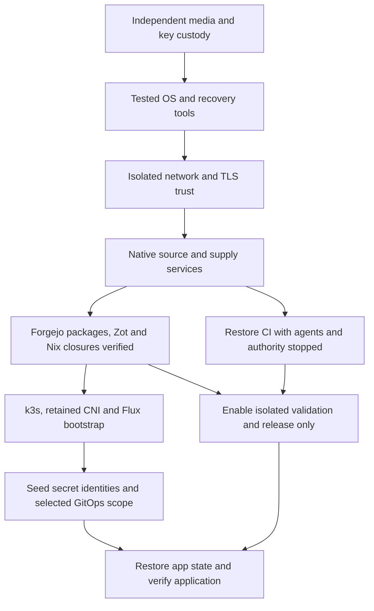

# Independent platform recovery

## Status and scope

This is the recovery plan and acceptance contract, inspected on 2026-10-14
against homelab source `1a34ee17ed62851af1e8d71f42baa10b197d617c`.
No recovery environment was created and no production service was stopped for
this review. Complete independent platform recovery remains **unproven**.
Bookshelf release work remains deferred by the operator.

The next executable milestone is a clean, isolated recovery of Darkbit from a
declared recovery checkpoint while the original NAS, production cluster, and
public internet are unreachable. A successful local rebuild, image archive, or
backup job is supporting evidence, not that milestone.

This plan covers local source, supply, CI, Kubernetes, secrets and application
state. Cloudflare public ingress, ACME issuance, R2 availability, external APIs,
and third-party purchasing are external integrations. LAN service acceptance
does not establish recovery of these external integrations.

Related procedures:

- [Application lifecycle contract](../research/2026-10-08-sovereign-application-lifecycle-rfc.md)
- [Forgejo and platform state recovery](forgejo-disaster-recovery.md)
- [Registry recovery](local-registry.md#backup-and-restore)
- [PostgreSQL recovery](postgres-disaster-recovery.md)
- [Router recovery](opnsense-recovery.md)

## Failure domains and permitted survivors

| Scenario | Unavailable | Eligible survivors | Claim after a passing test |
| --- | --- | --- | --- |
| A: NAS storage loss | NAS system/data pools, including Forgejo, Zot, Attic and Garage | Surviving compute nodes, operator workstation, independently held keys, detached backup disk if demonstrably intact, offsite repository | Recovery from lost NAS storage; surviving node caches must be declared |
| B: complete NAS loss, WAN available | NAS hardware and every disk attached to it | Operator-held recovery media, independently held keys, verified offsite backups, surviving compute nodes | Recovery independent of the NAS; still dependent on offsite provider and WAN |
| C: NAS and cluster loss, WAN denied | Original NAS, attached backup disk, all production nodes and their caches, production DNS and public services | A clean replacement host, explicitly exported offline recovery media and separate key custody | Independent local recovery for the tested checkpoint and workloads |

Use scenario C for the governing sovereignty test. A backup disk mounted on the
NAS is a separate storage device, not an assumed survivor of losing the whole
NAS. R2 is useful for B; C needs a complete, verified offline export made before
the simulated loss. A directory under `/home/rupan/sovereign-recovery` is off the
NAS, but is not proven offsite, immutable, or protected against loss of the
workstation. Record the workstation as a survivor only when the scenario allows
it, and copy the sealed checkpoint to another independently held device.

## Observed state and limits

These observations identify recovery inputs; they do not certify a complete set.

| Component | Authoritative source and recovery material | Coverage or evidence | Remaining acceptance gap |
| --- | --- | --- | --- |
| Forgejo | `flake/modules/forgejo.nix`; `/persist/forgejo` including `data/forgejo.db`, repositories under `/tank/forgejo/repositories` | Platform backup snapshots `/persist/forgejo` and `tank/forgejo` | Restore DB, repositories, package blobs, LFS, attachments and configuration together; exercise package download, Git clone and authentication |
| Woodpecker | `flake/modules/woodpecker.nix`; `/persist/woodpecker/server-data/woodpecker.sqlite`, top-level credential/config files | Platform backup uses SQLite online backup and copies top-level files | Restore server and signed policy with agents stopped; verify repository IDs, secrets, OAuth and protected status contexts against restored Forgejo |
| Garage and infrastructure state | `flake/modules/nas-s3.nix`, `flake/modules/tofu-state.nix`; `/persist/garage`, `/tank/s3`, `/persist/tofu-state` | Platform backup stops Forgejo/Garage for ZFS snapshots and separately snapshots state SQLite and TLS/credential files | Prove metadata/object consistency and exact state serials/lineages; keep state writers and CI authority disabled until validated |
| Platform backup destination | `flake/modules/platform-backup.nix`, `scripts/ci/platform_backup.py`; `/persist/platform-backup.env` | Live NAS and homelab-04 environments were mode 0600 and pointed at R2; timers enabled. Last observed exits: NAS 2026-10-14 12:05:15 CDT, runner 12:00:39 CDT, both success | Job success is not a restore receipt; independent password/access custody and complete offline repository export remain preflight requirements |
| Zot | `flake/modules/zot-registry.nix`, `flake/modules/nas-data.nix`; `/tank/registry`, `/persist/zot`, `/var/lib/acme` | Registry backup declares encrypted Restic on `/mnt/backup-2tb/registry-restic`, excludes its own password, prunes daily/weekly/monthly generations, checks a subset | Verify actual snapshot freshness, recover the password independently, export accepted/rollback/bootstrap images and restore-test them; same-host disk does not cover B or C |
| Attic | `flake/modules/nas-data.nix`; `/persist/attic/server.db`, `/persist/attic/env`, `/tank/attic` | Local snapshots are declared; the inspected platform backup does not export these paths | Export a consistent cache or complete required Nix closures plus signatures and trust metadata. A top-level NAR without its references is insufficient |
| npm and other build supply | `flake/modules/npm-cache-proxy.nix`, `config/ci/applications.json`, `services/*/` | npm endpoint is an nginx pull-through cache, explicitly disposable; application lanes retain named supply in Forgejo packages | Verify every selected lock entry/toolchain against restored package files. A cache miss must fail offline; do not count this endpoint as a retained Verdaccio registry |
| Host and container bootstrap | `flake/`, `registry/images.lock.json`, fleet source bundles | Laptop/ISO publication receipt exists under `nixos/2026-10-13/publication-1600/`; ISO extraction and signature/hash checks recorded | ISO boot and laptop full-closure restore are unproven; neither receipt establishes replacement NAS/server OS closures, recovery utilities or all bootstrap images |
| k3s and Cilium | `flake/modules/k3s-server.nix`; `/persist/etcd-snapshots`, server token and registry credentials | Source schedules daily 03:00 etcd snapshots with retention 14; Cilium images use local digest pins | No independent etcd/token export was found in the inspected platform backup. Cilium chart 1.20.1 still uses `https://helm.cilium.io`; retain chart bytes/digest and Helm installer dependencies before scenario C |
| Flux and secret distribution | `gitops/clusters/homelab-01/flux-system/`, `gitops/clusters/homelab-01/secrets.yaml`, `.sops.yaml` | Git source is Forgejo SSH; secrets Kustomization requires `flux-system/sops-age` | Retain Flux controller images/manifests, Git read credential, SSH known hosts and an independently decryptable age identity. Secret ciphertext in Git cannot bootstrap its own missing key |
| Application state | Application catalog, app manifests and individual recovery runbooks | Separate DB dumps, selected PVC backups and prior per-app restore receipts exist | Build a per-app state/backup/key ledger, including node-local data, media references and models; platform backup is not a backup of every PVC |
| Native voice | `services/voice-supply/`, `docs/runbooks/jarvis-voice.md` | Off-NAS archive `voice/2026-10-13/native-images-1700.tar.gz`: 5,562,598,114 bytes, 114 OCI blobs verified; accepted/rollback/base roots present; production and transcript receipts retained | This proves those artifacts and runtime checks, not a fresh Docker-store restore or recovery of the complete voice platform |

Platform snapshots on NAS and runner have separate timestamps. They are not an
atomic cross-host checkpoint. Reconcile Forgejo refs, package versions, CI
records and state fingerprints before selecting an accepted checkpoint.
The existing Forgejo GitLab failover procedure requires surviving NAS state and
an external GitLab service; it is not the scenario C bootstrap route.

## Circular dependencies and the escape paths

| Cycle or hidden dependency | Required escape path |
| --- | --- |
| Rebuilding the NAS needs Nix inputs from Attic on that NAS | Boot a retained, tested installer and import complete signed host/recovery-tool closures from offline media before any Nix evaluation needing remote fetches |
| Restoring Zot needs a Zot image from Zot | Start the native Zot service from the imported NixOS closure, or a separately exported verified OCI image with an already available engine; do not pull it from the lost registry |
| Offline CI needs Forgejo packages, but restoring Forgejo needs CI | Restore Forgejo DB/files/packages directly with preinstalled tools; CI is not a bootstrap prerequisite |
| Flux needs Forgejo and age credentials, while secret distribution needs Flux | Seed only the Git read/known-hosts, registry-read and SOPS bootstrap identities from independent escrow before enabling reconciliation |
| Cluster networking needs a Helm chart fetched before networking is operational | Retain the exact Cilium chart, installer image, rendered configuration and required CNI/bootstrap images; make the drill use these retained inputs |
| State recovery needs Garage and its metadata/secrets | Restore Garage metadata, object data and RPC identity as one checkpoint before state clients; verify state backend authority instead of initializing an empty backend |
| Restic password or R2 access is stored only in the backup or lost host | Keep decryption material separately and test access from the recovery host; provide an offline Restic repository export or fully restored checkpoint for C |
| Private DNS, public ACME, SSO or NetBird is needed to reach recovery services | Use console access, isolated static addressing/private DNS and retained valid TLS trust or an isolated recovery CA; do not disable TLS verification or require public identity/network services |

Source and supply restore can run in parallel after networking and tools are
available. Start CI execution after its source, supply and policy are verified.
Existing applications do not need CI or Forgejo continuously to keep running.

## The sealed checkpoint

Create one manifest outside the failed infrastructure. Each entry records a
logical name, exact source revision or snapshot ID, size, SHA-256, platform,
creation and verification UTC times, storage device/location, encryption and
trust-key references, dependencies, restore procedure, and retention owner.
Keep secret values out of the manifest and Git. Hashes establish integrity
against a trusted manifest; sign it or retain it through independent trusted
custody so an altered archive and altered manifest cannot authenticate each other.

The minimum pack contains:

1. Tested installer, boot instructions and recovery-tool binaries/closures
   (Nix, Git, Restic, age/SOPS, TLS, archive utilities, OCI engine/tools, kubectl
   and the matching k3s/Flux bootstrap tooling). Record CPU architecture and
   virtualization requirements. Importing the toolchain must not require Nix
   evaluation, public package resolution or the missing NAS.
2. Complete NixOS closures for the replacement storage/control hosts and their
   reference closure, pinned flake inputs/source archives, lock files, cache
   signatures and public trust keys. Building from source additionally requires
   every build-time input; importing an OS closure proves artifact recovery only.
3. Homelab, pilot and required upstream/submodule Git bundles; verify refs,
   `git bundle verify` and `git fsck`. Preserve accepted build source and deployed
   configuration identities separately from the latest branch tip.
4. A consistent Forgejo backup including packages/LFS/attachments, runner backup,
   Garage metadata/objects and state-backend checkpoint. Include the exact
   policy source and authority configuration, with sensitive files encrypted.
5. OCI manifests/indexes, configs, layers and required referrers for pilot,
   rollback, CI tools and cluster/bootstrap dependencies. Preserve original
   manifest digests; an engine export or tag alone is not sufficient evidence.
6. The pilot's complete dependency/toolchain supply and inventory hashes, plus
   Cilium chart/installer, Flux manifests and every Helm/OCI chart needed by the
   selected recovery scope. An image mirror does not retain Helm chart bytes.
7. A deliberate cluster choice: a verified etcd snapshot with its matching server
   token and restore procedure, or a documented fresh-cluster reconstruction from
   Git and application state. A fresh cluster does not preserve historical
   Kubernetes objects, identities or etcd state. The minimal pilot may use the
   fresh-cluster route; a claim of exact cluster restoration requires the former.
8. Selected application state, migration version, model/media assets and backup
   metadata. For databases, include the compatible engine, schema/application
   version and point-in-time consistency evidence. Bookshelf is excluded from
   this pilot, not silently counted as recovered.
9. Independently accessible decryption keys, Restic password/access references,
   registry and Forgejo trust/authentication inputs, TLS material or recovery CA,
   DNS/address map and console recovery instructions. Verify custody without
   printing keys. Existing production secrets stay in encrypted offline escrow;
   the shadow environment uses isolated identities wherever supported.

Before sealing, compare all manifest references with actual files and hash every
required object. Retain at least two checkpoint generations on independent media
until the newer generation has passed recovery. Do not depend on production
pruning policies to preserve the chosen recovery point.
Record replacement-host CPU/RAM and a space budget covering the restored data,
unpacked closures/images, temporary staging and measured writable headroom.
Identify the actual independent host and media before gate 0 can pass.

## Isolation contract

Use a disposable VM with its own network namespace and virtual disk. Multiple
VMs may share an isolated virtual switch. Deny public and production routes at
the hypervisor/virtual-switch boundary before boot; Kubernetes NetworkPolicy
alone cannot isolate bootstrap activity. Declare the hosting hypervisor as a
survivor, not an invisible dependency. A VM hosted on a production node cannot
prove loss of all production compute.

- Supply read-only copies of recovery media and explicit writable scratch disks.
  Do not expose production ZFS datasets, NFS exports, Docker sockets or SSH agents.
- Prove production NAS/control-plane addresses, public IPs, IPv6 paths, public
  DNS and alternative host gateways cannot be reached. Retain failed connection
  tests and firewall counters. Permit only documented in-drill endpoints.
- Give any restored canonical hostnames private in-drill addresses; route neither
  original `10.0.30.0/24` nor production pod/service networks from the drill.
  Inventory hardcoded addresses as well as DNS: registry `/etc/hosts` entries,
  CI/SSH helpers and state endpoints need a reviewed drill overlay. Prepare any
  required replacement closures before sealing the pack, retain the overlay and
  its output identities, and keep application source unchanged. Do not solve
  a failed bootstrap by temporarily allowing the original NAS.
- Do not run a second Docker daemon in the production host's network namespace.
  The prior native-image drill disturbed `docker0` despite a separate data root
  and `bridge=none`. A separate socket/data root is insufficient isolation.
- Restore schedulers and automation stopped. Disable copied CI queues, maintenance
  crons, mirroring, Renovate, Discord/HA actions, backup pruning and provider
  operations in the restored environment. Preserve the original archive; make
  drill-specific configuration changes only on copies.
- Reconcile a pilot-only Flux overlay initially. Do not apply the whole production
  root and assume outbound blocking prevents every unwanted local write.
  Every PVC/hostPath must resolve to a restored drill-owned volume.

## Ordered test and acceptance gates

Measure two clocks: total recovery starts with a blank replacement environment
and sealed pack; application recovery starts when verified local source/supply
and the selected cluster prerequisites are ready. Record phase durations,
operator interventions, failed attempts and missing inputs instead of resetting
the clock after a failure.

| Gate | Action | Pass condition and evidence |
| --- | --- | --- |
| 0: checkpoint audit | Select scenario C and independently open keys/media; verify the complete manifest | Every required object exists and hashes match; every key can decrypt its designated test object; all dependencies resolve to declared survivors. Missing inputs stop here |
| 1: clean boot and isolation | Boot replacement VM from the retained installer, import recovery tools and establish isolated DNS/TLS | Empty image/build stores documented; blocked WAN/production/IPv6 probes fail; valid in-drill TLS succeeds; no public downloads or production mounts |
| 2: restore source and supply | Restore Forgejo and its package store, isolated Zot, selected Nix closures and Garage/state if included | SQLite integrity, Git refs/fsck, representative package hashes, full required OCI graph hashes and manifest identities verified; state object bytes/lineages/serials match the checkpoint |
| 3: restore control prerequisites | Install retained k3s/Cilium/Flux inputs; seed escrowed bootstrap keys; restore CI server/policy with executors stopped | Nodes Ready, CNI works, Flux reads restored Forgejo; SOPS decrypts selected manifests; all image/chart reads come from retained sources; neither CI nor Flux can reach production |
| 4: artifact recovery | Import the accepted pilot image and apply only its restored GitOps scope | Flux at the selected source revision, pod imageID matches retained digest, local HTTP/content/assets match the acceptance hashes; this establishes artifact recovery only |
| 5: rebuild recovery | Start isolated sandbox/release agents; clone exact source and build with empty writable caches using restored supply | Actual validation and release succeed under server-owned policy; source/provenance and resulting digest recorded. Missing one required input fails closed before it is restored. Do not require bit-identical output unless separately demonstrated |
| 6: promotion and rollback | Promote the rebuilt image by protected PR on restored Forgejo, reconcile Flux, then exercise rollback | Required exact-head status gates enforce the merge; runtime matches the promoted digest/content; retained previous release can be re-applied and verified; no production publication |
| 7: selected stateful recovery | In a later cohort, restore one app-owned DB/PVC into isolated volumes, run integrity and functional checks | Actual application reads restored data, a reversible write persists across a drill restart, migration/rollback constraints are documented and measured data loss is within its declared target |
| 8: receipt and teardown | Seal logs, measured times, policy/network evidence, recovered identities and limitations | Reviewer can reproduce the result from named assets; export receipts before deleting only positively identified drill resources; production remains unchanged |

For the stateless pilot, target no loss of source/assets accepted into the sealed
checkpoint and application availability within 60 minutes after prerequisites
are ready, as proposed in the lifecycle RFC. Measure total bootstrap duration
separately; no full-platform RTO has been demonstrated or promised. For stateful
cohorts, declare an RPO and phase timeout from the actual backup cadence before
starting. Measure loss against the last consistent recovered transaction or
application checkpoint, not the timer's configured interval.

Each gate records UTC start/end, accepted source and image identities, snapshot
IDs, byte/hash verification, commands and exit status, credentials by reference,
network allow/deny evidence, resulting runtime checks, measured loss and explicit
limitations. Put sensitive logs in mode-0600 evidence storage; publish a sanitized
receipt. A retry records the original failure and the intervention. For example,
native release 1700 needed an operator upload retry and remains failed CI despite
its later successful production acceptance.

## First pilot and implementation queue

Use **Darkbit**, catalog repository `JEFF7712/darkbit-site`, Woodpecker repository
2, `static-site-v1`, namespace `darkbit`, Deployment `website-deploy`.
Read-only preflight on 2026-10-14 observed main at
`d29a34fe81eebd8b344ce4a56d428508704a36de`, one available replica, image
`sha256:9387340adce2259a4918a7ab5c243e64f557d99f51fc27f2c340a4a56d960623`.
The 2026-10-08 checkpoint's cold-proof receipt records source
`06a94923008597dd32dcaa61d18950d8b3f23555`, empty initial image storage,
network-denied assembly/runtime and hashes for HTML, CSS and an actual asset.
It explicitly did not test full Woodpecker or platform recovery. Keep that
receipt as historical evidence; reconcile both source identities/provenance
when selecting the new checkpoint instead of substituting current main for the
source that produced the deployed image.

Darkbit requires no database, GPU or public integration to render, so it exposes
bootstrap problems without entangling state migration or voice hardware.
The pilot must use the actual server-owned release implementation and its tool
images from `config/ci/applications.json` and `scripts/ci/static_release.py`.
An ad-hoc successful container build alone does not satisfy gate 5.

Execute the remaining work serially:

1. **Assemble and seal the pilot pack.** Close missing NAS/recovery-tool closures,
   offline R2 exports, independently held keys, required OCI/Helm/bootstrap inputs
   and Forgejo package coverage. Produce a machine-readable completeness report
   before provisioning anything. A historical builder directory is evidence,
   not a substitute for a portable export.
2. **Boot the isolated recovery host.** Verify installer boot and isolation first.
   Restore native source/supply services, then the minimal fresh-cluster route
   and CI. Run gates 0 through 6 and 8 for Darkbit.
3. **Close the result.** Record measured total/application RTO and failures. A
   partial restore remains partial; repair missing inputs and rerun from a clean
   environment before accepting independent recovery.
4. **Expand by state and hardware requirements.** Add one stateful service with a
   verified backup/key chain, then further applications and GPU services. Decide
   whether to restore etcd or accept Git reconstruction. Keep Bookshelf deferred.
5. **Automate the proven checks.** Add scheduled clean rebuild/restore exercises
   and checkpoint completeness/retention checks after the first successful drill.
   Reuse the measured recipe for application scaffolds; do not add a new portal
   or orchestration service to make the first recovery possible.

The next task is pack assembly and completeness verification. This document
authorizes no claim that the independent drill, ISO boot, full etcd restoration
or every application recovery has already passed.
